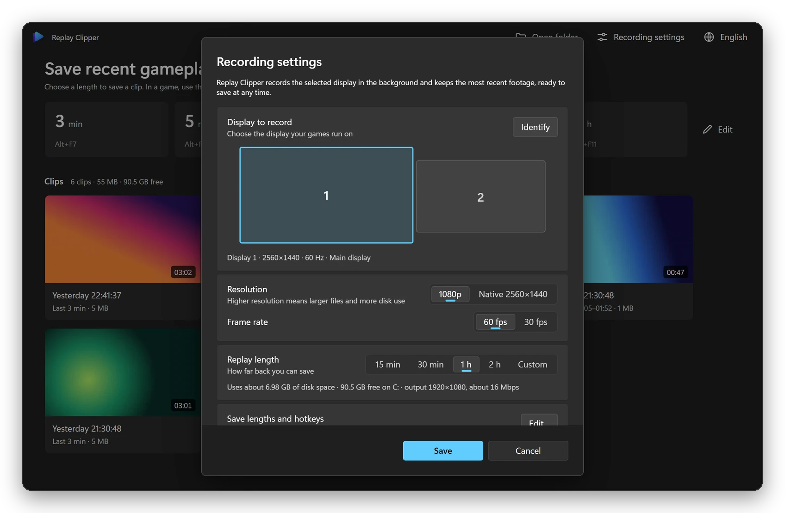
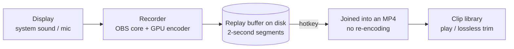

<div align="center">


# Replay Clipper

**That play you just made? It's not too late to keep it.**

Like the "save recent gameplay" button on a console: Replay Clipper records in the background,<br>
and one hotkey saves the last 3, 5 or 30 minutes as a video.

[](https://github.com/Lunafreya123/ReplayClipper/releases/latest)

[](LICENSE)

[简体中文](README.md) · English

</div>

<p align="center"></p>

## Features

### Always recording, ready when you are
- Records the display you choose and the system sound, optionally your microphone too. Only the most recent footage is kept; older footage is dropped automatically.
- Replay length of 15 min, 30 min, 1 h, 2 h, or anything from 1 to 720 minutes (12 hours).
- The replay buffer lives on disk, not in memory. Recording settings show the disk space your choice needs, worked out from resolution, frame rate and length, next to the free space. Recording stops on its own when less than 1 GB is left, so the disk never fills up.

### One key to save, next to no waiting
- Up to five save lengths on the home page, 3, 5, 15 and 30 minutes by default. Every length can be changed and given its own hotkey.
- Hotkeys work everywhere, including in games. A small notice appears in the top-right corner and a sound plays when the clip is ready.
- Saving joins the footage that is already recorded, without re-encoding, so there is no quality loss. On the development PC (NVMe SSD) 5 minutes save in about 0.2 s and 30 minutes in about 1 s.

### Hardware encoding, no frame-rate hit
- Uses NVIDIA NVENC, AMD AMF or Intel Quick Sync automatically, in H.265 or H.264. Software encoding is only a fallback when no hardware encoder is available, and the app tells you when that happens.
- 1080p, 1440p or the display's native resolution, at 60 or 30 fps.

### Built-in player and lossless trimming
- Clip library with thumbnails; playback at 0.5× to 4×.
- Frame-accurate trimming: zoom the timeline with the mouse wheel, set start and end with I / O, nudge by single frames. Export does not re-encode either.

### Lives in the tray like any other app
- Closing the window asks whether to keep running in the background or exit, with a "Don't ask again" option.
- The tray menu can save clips and start or stop recording directly.
- Optionally starts with Windows and records in the background.

### Self-contained
- No separate OBS installation needed. The recorder is built on OBS Studio's core libraries, which come with the installer.
- Chinese and English interface, switchable at any time.
- Installs without administrator rights. Uninstalling removes everything except your saved clips.

## Screenshots

<table>
<tr>
<td width="50%"><p align="center">Your own save lengths and hotkeys</p></td>
<td width="50%"><p align="center">Recording settings with a live disk estimate</p></td>
</tr>
</table>

<p align="center"><br>Playback and frame-accurate trimming</p>

## Install

1. Open [Releases](https://github.com/Lunafreya123/ReplayClipper/releases/latest) and download `ReplayClipper-Setup-x.y.z.exe`.
2. Run it. The installer is not code-signed, so Windows may show "Windows protected your PC": choose "More info" → "Run anyway".
3. On first start, Recording settings opens. Pick the display to record and select "Start recording". From then on the app records in the background.

Requirements:

- Windows 10 or 11, 64-bit
- WebView2 Runtime (built into Windows 11; on Windows 10 it usually comes with Edge)
- A GPU with a hardware video encoder (NVIDIA / AMD / Intel) is recommended

## Default hotkeys

| Save the last | Hotkey |
| --- | --- |
| 3 minutes | `Alt + F7` |
| 5 minutes | `Alt + F8` |
| 15 minutes | `Alt + F9` |
| 30 minutes | `Alt + F10` |

Change them with "Edit" after the save tiles on the home page (up to five). Function keys work on their own; other keys need Ctrl or Alt.

## FAQ

**Why is saving so fast?**
While recording, the footage is already written to disk in 2-second pieces. A save puts the pieces it needs straight into an MP4 without re-encoding anything.

**Does it cost frame rate?**
Encoding runs on the GPU's dedicated video encoder, not on the cores the game uses. On the development PC the recorder itself uses about 7% of one CPU core.

**How much disk space does it need?**
At the default 1080p, 60 fps and about 16 Mbps: roughly 3.5 GB for 30 minutes, 7 GB for an hour. Recording settings show the figure for your choice.

**Where do clips go?**
To "Videos\Replay Clipper" unless you choose another folder in Recording settings. "Open folder" in the title bar opens it.

**Does it keep recording when I close the window?**
If you chose "Keep running in background", yes, and the hotkeys keep working. Only "Exit" in the tray menu really closes it; footage that was not saved is discarded.

## How it works



- **App** (`src/`): the window and background service, in C#. The interface is a single web page (`ui/index.html`) shown with WebView2.
- **Recorder** (`engine/`): a headless helper that drives the core libraries of OBS Studio 33.0.1 for screen and audio capture and hardware encoding, and writes a ring of segments to disk. The app talks to it over a named pipe and restarts it if it crashes. Protocol: [`src/engine/PROTOCOL.md`](src/engine/PROTOCOL.md).
- **Saving**: the app reads the segments and writes the MP4 itself. On every save ffmpeg converts the first segment as a referee, and the app's result must match it byte for byte; on any difference the clip is joined by ffmpeg instead, so a save never produces a broken file.

## Known limitations

- Fully tested only on Windows 11 with an AMD GPU. The NVIDIA and Intel encoder settings follow OBS's recommendations but have not been tried on real hardware yet. If something goes wrong, please open an [issue](https://github.com/Lunafreya123/ReplayClipper/issues) and attach `data\engine\logs\engine.log`.
- Exclusive-fullscreen games and HDR have not been tested.
- No AV1 encoding for now.

## Building

Everything compiles with the C# compiler that ships with Windows (.NET Framework 4.x, C# 5); no Visual Studio is needed. Binary dependencies are not stored in the repository and go into these folders first:

| Folder | What | Where from |
| --- | --- | --- |
| repository root | `Microsoft.Web.WebView2.Core.dll`, `Microsoft.Web.WebView2.WinForms.dll`, `WebView2Loader.dll` | NuGet package [Microsoft.Web.WebView2](https://www.nuget.org/packages/Microsoft.Web.WebView2) 1.0.2903.40 (folders `lib\` and `runtimes\win-x64\native\`) |
| `engine\bin\64bit\` | `obs.dll` and the other files under `bin/64bit/` in [`engine/licenses/FILES.sha256.txt`](engine/licenses/FILES.sha256.txt) | the official Windows x64 build of [OBS Studio 33.0.1](https://github.com/obsproject/obs-studio/releases/tag/33.0.1), folder `bin\64bit` |
| `engine\core\<name>\` | `<name>.dll` for win-capture, win-wasapi, obs-ffmpeg, obs-x264, obs-nvenc, obs-qsv11 | the same OBS build, folder `obs-plugins\64bit` |
| `engine\data\libobs\` | the `*.effect` files | the same OBS build, folder `data\libobs` |
| `ffmpeg\` | `ffmpeg.exe` (FFmpeg 9.0.2) | built with [`tools/ffmpeg/build-ffmpeg.sh`](tools/ffmpeg/build-ffmpeg.sh), see [`ffmpeg/README.txt`](ffmpeg/README.txt) |

Copy the OBS files unchanged and check them against `FILES.sha256.txt`. Do not copy any plugin data folders: without them OBS makes no network requests.

Then:

```bat
build.cmd                         :: ReplayClipper.exe, Uninstall.exe, engine\bin\64bit\ReplayClipperEngine.exe
installer\build-installer.cmd     :: dist\ReplayClipper-Setup-<version>.exe (needs Inno Setup 6 in tools\innosetup or %ISCC%)
```

Close any copy of the app that runs from this folder first. The app can run straight from the repository folder; it then keeps its settings in `data\`. `tools/engine-tools/` holds the test harness for the recorder and the save path.

## License

[GPL-3.0](LICENSE). The recorder helper (`src/engine/`) is GPL-2.0-or-later.
Versions, licenses and source locations of the bundled third-party components (OBS Studio core, FFmpeg and others) are listed in [`engine/licenses/THIRD-PARTY-NOTICES.txt`](engine/licenses/THIRD-PARTY-NOTICES.txt).

"OBS" and "OBS Studio" are trademarks of their respective owners. Replay Clipper is not affiliated with or endorsed by the OBS Project.
