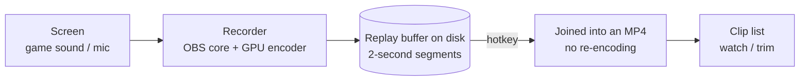

<div align="center">


# Replay Clipper

**Pulled off something great and weren't recording? Replay Clipper was.**

It keeps recording in the background while you play. When something worth keeping happens, press `Alt + F7` and the last 3 minutes are saved.<br>
Think of the "save recent gameplay" button on a console, only for Windows.

[](https://github.com/Lunafreya123/ReplayClipper/releases/latest)

[](LICENSE)

[简体中文](README.md) · English

</div>

<p align="center"></p>

## What it does

### Recording
- Records the screen you pick, together with the game sound. Want your voice on it too? Turn on the microphone.
- Keep anything from the last 15 minutes up to the last 12 hours. Older footage is deleted as it goes, so it never piles up.
- The buffer lives on your disk, and Recording settings show how much space it will take before you commit. If the disk gets down to its last 1 GB, recording stops by itself instead of filling it up.
- Encodes on the GPU (NVIDIA NVENC, AMD AMF, Intel Quick Sync), in H.265 or H.264. It only falls back to CPU encoding when there is no hardware encoder at all; that costs frames, and the settings will tell you.
- 1080p, 1440p or your screen's native resolution, at 60 or 30 fps.

### Saving
- Five save buttons on the home page, 3, 5, 15 and 30 minutes out of the box. Change the lengths and the hotkeys to whatever suits your hands.
- Press the hotkey right in the game, no alt-tabbing. A small notice pops up in the corner and a chime tells you it's saved.
- Nothing is re-encoded, so the clip looks exactly like the recording. On my own PC (NVMe SSD) saving 5 minutes takes about 0.2 s and 30 minutes about 1 s, which is to say: it's done by the time you let go of the key.

### Watching and trimming
- The clip list has thumbnails. Slow down to 0.5× to see what really happened, or speed up to 4× through the boring bits.
- Trim to the exact frame: zoom the timeline with the mouse wheel, mark start and end with I and O, then nudge frame by frame. Export doesn't re-encode either.

### After you close the window
- Clicking × asks whether to keep running in the background or quit. Tired of the question? Tick "Don't ask again".
- In the background it sits in the notification area; its menu can save clips and turn recording on or off.
- Let it start with Windows and begin recording on its own, and you never have to think about it again.

### Also
- No need to install OBS. The recorder uses OBS Studio's core libraries, which come with the installer.
- Chinese or English interface, switchable from the top-right corner.
- No administrator rights needed to install. Uninstalling removes the program, its settings and the buffer, and leaves every clip you saved alone.

## Screenshots

<table>
<tr>
<td width="50%"><p align="center">Lengths and hotkeys the way you like them</p></td>
<td width="50%"><p align="center">Recording settings, disk use at a glance</p></td>
</tr>
</table>

<p align="center"><br>Slow motion and frame-accurate trimming to cut out the highlight</p>

## Installation

1. Grab `ReplayClipper-Setup-x.y.z.exe` from [Releases](https://github.com/Lunafreya123/ReplayClipper/releases/latest).
2. Run it. The installer isn't code-signed yet, so Windows may say "Windows protected your PC". Select "More info", then "Run anyway".
3. The first time it opens, Recording settings come up. Pick the screen to record and select "Start recording". That's it; from here on it just runs.

You need:

- Windows 10 or 11, 64-bit
- WebView2 Runtime (built into Windows 11; on Windows 10 it usually came with Edge)
- Ideally a GPU with a hardware encoder: NVIDIA, AMD and Intel graphics all work

## Default hotkeys

| Save the last | Hotkey |
| --- | --- |
| 3 minutes | `Alt + F7` |
| 5 minutes | `Alt + F8` |
| 15 minutes | `Alt + F9` |
| 30 minutes | `Alt + F10` |

To change them, select "Edit" after the save buttons on the home page (up to five). Function keys such as F1 to F12 work on their own; other keys need Ctrl or Alt.

## FAQ

**Saving is that fast? Is it cutting quality somewhere?**
No. While recording, the footage already goes to disk in 2-second pieces. Saving just puts the pieces it needs into one MP4, without re-encoding anything.

**Will it slow my game down?**
Encoding runs on the GPU's dedicated encoder. On my PC the recorder itself uses about 7% of one CPU core. If your GPU has no hardware encoder and it has to encode on the CPU, though, you will lose frames.

**How much disk space does it need?**
At the default 1080p, 60 fps (about 16 Mbps), keeping 30 minutes takes about 3.5 GB and keeping an hour about 7 GB. Recording settings show the number for your own settings.

**Where do my clips go?**
Into a Replay Clipper folder in your Videos folder, unless you pick another one in Recording settings. "Open folder" in the title bar takes you there.

**Is it still recording after I close the window?**
If you chose to keep it running in the background, yes, and the hotkeys still work. "Exit" in the tray menu really closes it, and whatever you haven't saved is gone, so save first.

## How saving is so quick



- **The app** (`src/`): written in C#; it owns the window, the hotkeys and the tray icon. The interface is a single web page (`ui/index.html`) shown with WebView2.
- **The recorder** (`engine/`): a small helper without a window. It uses the core libraries of OBS Studio 33.0.1 to capture picture and sound, encodes them on the GPU and writes them piece by piece into a ring buffer on disk. The app talks to it over a named pipe and brings it straight back if it ever exits unexpectedly. Protocol: [`src/engine/PROTOCOL.md`](src/engine/PROTOCOL.md).
- **Saving**: the app reads the segments and writes the MP4 itself. To be safe, ffmpeg also converts the first segment on every save, and the two have to match byte for byte. If they don't, ffmpeg joins the whole clip instead: slower, but solid.

## Not there yet

- I have only tested it fully on my own Windows 11 PC with an AMD GPU. The NVIDIA and Intel encoder settings follow OBS's recommendations but haven't run on real hardware yet. If something goes wrong, please open an [issue](https://github.com/Lunafreya123/ReplayClipper/issues); attaching `data\engine\logs\engine.log` helps a lot.
- Exclusive-fullscreen games and HDR haven't been tested.
- No AV1 encoding for now.

## Building

Everything compiles with the C# compiler that ships with Windows (.NET Framework 4.x, C# 5); Visual Studio is not needed. The binary dependencies are not in the repository. Put them in these folders first:

| Folder | Files | Source |
| --- | --- | --- |
| repository root | `Microsoft.Web.WebView2.Core.dll`, `Microsoft.Web.WebView2.WinForms.dll`, `WebView2Loader.dll` | NuGet package [Microsoft.Web.WebView2](https://www.nuget.org/packages/Microsoft.Web.WebView2) 1.0.2903.40 (folders `lib\` and `runtimes\win-x64\native\`) |
| `engine\bin\64bit\` | `obs.dll` and the other files listed under `bin/64bit/` in [`engine/licenses/FILES.sha256.txt`](engine/licenses/FILES.sha256.txt) | the official Windows x64 build of [OBS Studio 33.0.1](https://github.com/obsproject/obs-studio/releases/tag/33.0.1), folder `bin\64bit` |
| `engine\core\<name>\` | `<name>.dll` for win-capture, win-wasapi, obs-ffmpeg, obs-x264, obs-nvenc and obs-qsv11 | the same OBS build, folder `obs-plugins\64bit` |
| `engine\data\libobs\` | the `*.effect` files | the same OBS build, folder `data\libobs` |
| `ffmpeg\` | `ffmpeg.exe` (FFmpeg 9.0.2) | built with [`tools/ffmpeg/build-ffmpeg.sh`](tools/ffmpeg/build-ffmpeg.sh), see [`ffmpeg/README.txt`](ffmpeg/README.txt) |

Copy the OBS files unchanged and check them against `FILES.sha256.txt`. Do not copy any plugin data folders; without them OBS makes no network requests.

Then:

```bat
build.cmd                         :: ReplayClipper.exe, Uninstall.exe, engine\bin\64bit\ReplayClipperEngine.exe
installer\build-installer.cmd     :: dist\ReplayClipper-Setup-<version>.exe (needs Inno Setup 6 in tools\innosetup or %ISCC%)
```

Close any copy of the app that runs from this folder first. The app can also run directly from the repository folder; it then keeps its settings in `data\`. `tools/engine-tools/` contains test tools for the recorder and the save path.

## License

[GPL-3.0](LICENSE). The recorder helper (`src/engine/`) is GPL-2.0-or-later.
Versions, licenses and source locations of the bundled third-party components (OBS Studio core libraries, FFmpeg and others) are listed in [`engine/licenses/THIRD-PARTY-NOTICES.txt`](engine/licenses/THIRD-PARTY-NOTICES.txt) and [`ffmpeg/README.txt`](ffmpeg/README.txt).

"OBS" and "OBS Studio" are trademarks of their respective owners. Replay Clipper is not affiliated with or endorsed by the OBS Project.
