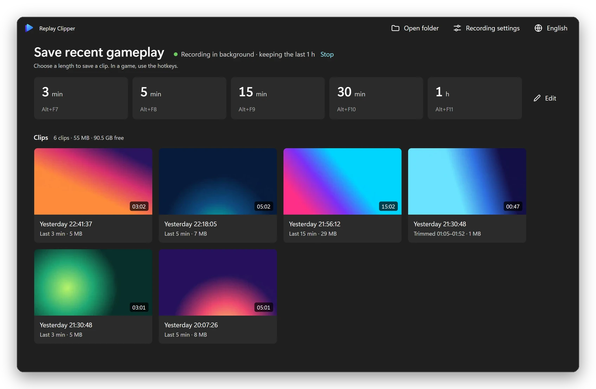
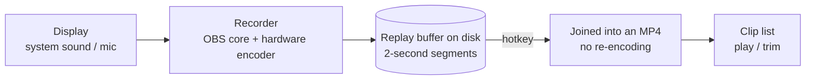

<div align="center">


# Replay Clipper

A replay recorder for Windows games. It records the screen in the background, and a hotkey saves the last few minutes as a video, much like the "save recent gameplay" feature of a game console.

[](https://github.com/Lunafreya123/ReplayClipper/releases/latest)

[](LICENSE)

[简体中文](README.md) · English

</div>

<p align="center"></p>

## Features

### Recording
- Records the selected display and the system sound in the background, optionally the microphone as well.
- Replay length of 15 min, 30 min, 1 h or 2 h, or a custom length of 1 to 720 minutes. Footage older than that is deleted automatically.
- The replay buffer is kept on disk. Recording settings show how much space the current resolution, frame rate and replay length need. Recording stops when less than 1 GB of disk space is left.
- Uses the GPU's hardware encoder (NVIDIA NVENC, AMD AMF, Intel Quick Sync) in H.265 or H.264. Without a usable hardware encoder it falls back to software encoding, and Recording settings say so.
- Resolution of 1080p, 1440p or the display's native resolution, at 60 or 30 fps.

### Saving
- Up to five save lengths on the home page, 3, 5, 15 and 30 minutes by default. Each length can be changed and given its own hotkey.
- The hotkeys also work inside games. A small notice appears in the top-right corner while saving, and a sound plays when the clip is done.
- A save joins the recorded segments without re-encoding, so the quality stays the same. On the development PC (NVMe SSD), saving 5 minutes takes about 0.2 s and 30 minutes about 1 s.

### Playback and trimming
- The clip list shows thumbnails. Playback speed of 0.5×, 1×, 2× or 4×.
- Frame-accurate trimming: zoom the timeline with the mouse wheel, set start and end with I and O, and adjust by single frames. Export does not re-encode.

### Running in the background
- When you close the window, you can choose to keep it running in the background or exit, and tick "Don't ask again".
- In the background, the app shows an icon in the notification area. Its menu can save clips and start or stop recording.
- It can start with Windows and record in the background.

### Other
- No OBS installation is needed. The recorder uses the core libraries of OBS Studio, which are included in the installer.
- Interface in Chinese or English.
- Installs without administrator rights. Uninstalling removes the program, its settings and the replay buffer; saved clips are kept.

## Screenshots

<table>
<tr>
<td width="50%"><p align="center">Save lengths and hotkeys</p></td>
<td width="50%"><p align="center">Recording settings</p></td>
</tr>
</table>

<p align="center"><br>Playback and trimming</p>

## Installation

1. Download `ReplayClipper-Setup-x.y.z.exe` from the [Releases](https://github.com/Lunafreya123/ReplayClipper/releases/latest) page.
2. Run it. The installer is not code-signed, so Windows may show "Windows protected your PC". In that case select "More info", then "Run anyway".
3. On first start, Recording settings opens. Select the display to record, then select "Start recording".

Requirements:

- Windows 10 or 11, 64-bit
- WebView2 Runtime (included in Windows 11; on Windows 10 usually installed with Edge)
- An NVIDIA, AMD or Intel GPU with a hardware video encoder is recommended

## Default hotkeys

| Save the last | Hotkey |
| --- | --- |
| 3 minutes | `Alt + F7` |
| 5 minutes | `Alt + F8` |
| 15 minutes | `Alt + F9` |
| 30 minutes | `Alt + F10` |

Select "Edit" after the save tiles on the home page to change them (up to five). Function keys can be used on their own; other keys need Ctrl or Alt.

## FAQ

**Why is saving fast?**
While recording, the footage is written to disk in 2-second segments. A save only joins the segments it needs into an MP4 file; nothing is encoded.

**Does it lower the game's frame rate?**
Video encoding is done by the GPU's dedicated encoder. On the development PC the recorder itself uses about 7% of one CPU core. With software encoding (no hardware encoder available) the frame rate drops noticeably.

**How much disk space does it use?**
With the default settings (1080p, 60 fps, about 16 Mbps), a 30-minute replay length takes about 3.5 GB and 1 hour about 7 GB. Recording settings show the figure for your settings.

**Where are clips saved?**
In the Replay Clipper folder inside your Videos folder, unless you choose another folder in Recording settings. "Open folder" in the title bar opens it.

**Does it keep recording after I close the window?**
If you chose to keep it running in the background, yes, and the hotkeys keep working. Selecting "Exit" in the notification area menu closes the app; footage that was not saved is discarded.

## How it works



- **App** (`src/`): written in C#; handles the window, hotkeys and tray icon. The interface is a single web page (`ui/index.html`) shown with WebView2.
- **Recorder** (`engine/`): a helper program without a window. It uses the core libraries of OBS Studio 33.0.1 to capture video and audio and encode them in hardware, and writes the result to a ring of segments on disk. The app talks to it over a named pipe and restarts it if it exits unexpectedly. Protocol: [`src/engine/PROTOCOL.md`](src/engine/PROTOCOL.md).
- **Saving**: the app reads the segments and writes the MP4 file itself. On every save, ffmpeg also converts the first segment for comparison, and the two must match byte for byte. If they do not, the whole clip is joined by ffmpeg instead.

## Known limitations

- Fully tested only on Windows 11 with an AMD GPU. The NVIDIA and Intel encoder settings follow OBS's recommended values but have not been verified on real hardware. If you run into a problem, please open an [issue](https://github.com/Lunafreya123/ReplayClipper/issues) and attach `data\engine\logs\engine.log`.
- Exclusive-fullscreen games and HDR have not been tested.
- AV1 encoding is not supported yet.

## Building

Everything compiles with the C# compiler that ships with Windows (.NET Framework 4.x, C# 5); Visual Studio is not needed. The binary dependencies are not in the repository. Put them in these folders first:

| Folder | Files | Source |
| --- | --- | --- |
| repository root | `Microsoft.Web.WebView2.Core.dll`, `Microsoft.Web.WebView2.WinForms.dll`, `WebView2Loader.dll` | NuGet package [Microsoft.Web.WebView2](https://www.nuget.org/packages/Microsoft.Web.WebView2) 1.0.2903.40 (folders `lib\` and `runtimes\win-x64\native\`) |
| `engine\bin\64bit\` | `obs.dll` and the other files listed under `bin/64bit/` in [`engine/licenses/FILES.sha256.txt`](engine/licenses/FILES.sha256.txt) | the official Windows x64 build of [OBS Studio 33.0.1](https://github.com/obsproject/obs-studio/releases/tag/33.0.1), folder `bin\64bit` |
| `engine\core\<name>\` | `<name>.dll` for win-capture, win-wasapi, obs-ffmpeg, obs-x264, obs-nvenc and obs-qsv11 | the same OBS build, folder `obs-plugins\64bit` |
| `engine\data\libobs\` | the `*.effect` files | the same OBS build, folder `data\libobs` |
| `ffmpeg\` | `ffmpeg.exe` (FFmpeg 9.0.2) | built with [`tools/ffmpeg/build-ffmpeg.sh`](tools/ffmpeg/build-ffmpeg.sh), see [`ffmpeg/README.txt`](ffmpeg/README.txt) |

Copy the OBS files unchanged and check them against `FILES.sha256.txt`. Do not copy any plugin data folders; without them OBS makes no network requests.

Then:

```bat
build.cmd                         :: ReplayClipper.exe, Uninstall.exe, engine\bin\64bit\ReplayClipperEngine.exe
installer\build-installer.cmd     :: dist\ReplayClipper-Setup-<version>.exe (needs Inno Setup 6 in tools\innosetup or %ISCC%)
```

Close any copy of the app that runs from this folder first. The app can also run directly from the repository folder; it then keeps its settings in `data\`. `tools/engine-tools/` contains test tools for the recorder and the save path.

## License

[GPL-3.0](LICENSE). The recorder helper (`src/engine/`) is GPL-2.0-or-later.
Versions, licenses and source locations of the bundled third-party components (OBS Studio core libraries, FFmpeg and others) are listed in [`engine/licenses/THIRD-PARTY-NOTICES.txt`](engine/licenses/THIRD-PARTY-NOTICES.txt) and [`ffmpeg/README.txt`](ffmpeg/README.txt).

"OBS" and "OBS Studio" are trademarks of their respective owners. Replay Clipper is not affiliated with or endorsed by the OBS Project.
