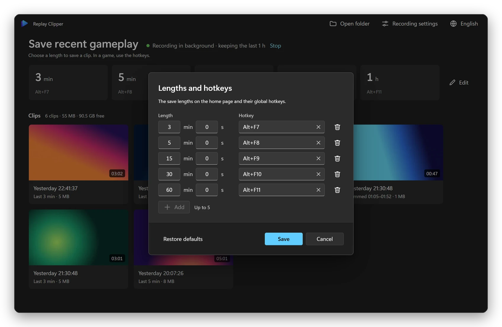
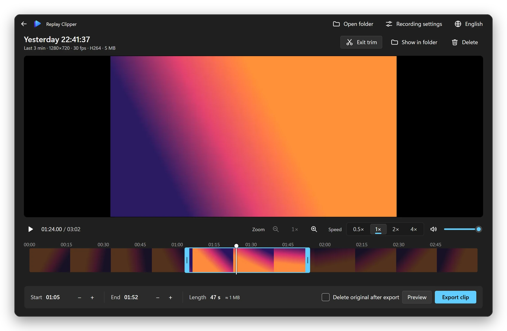
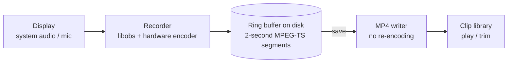

<div align="center">


# Replay Clipper

Instant replay recorder for Windows games

[](https://github.com/Lunafreya123/ReplayClipper/releases/latest)

[](LICENSE)

[Download](https://github.com/Lunafreya123/ReplayClipper/releases/latest) · [Issues](https://github.com/Lunafreya123/ReplayClipper/issues) · [简体中文](README.md)

</div>

Replay Clipper records the screen continuously in the background and saves the most recent footage as a video file when you press a global hotkey, similar to the "save recent gameplay" feature of game consoles. Recording is built on the core libraries of OBS Studio, and clips are saved by joining the recorded footage without re-encoding.

<p align="center"></p>

## Features

- **Continuous background recording**: records the selected display and system audio, optionally the microphone. The replay length can be set from 15 minutes to 12 hours; older footage is discarded automatically.
- **Hotkey saving**: up to five save lengths (3, 5, 15 and 30 minutes by default), each with its own global hotkey that also works in games.
- **Fast, lossless saving**: clips are joined from the segments in the disk buffer without re-encoding, so quality is unchanged. A 30-minute clip saves in about one second (see [Performance](#performance)).
- **Hardware encoding**: NVIDIA NVENC, AMD AMF and Intel Quick Sync, producing H.265 or H.264, with a software fallback when no hardware encoder is available. 1080p, 1440p or native resolution at 60 or 30 fps.
- **Disk-backed buffer**: the replay buffer is stored on disk. The settings dialog estimates the required space from resolution, frame rate and replay length, and recording stops automatically when less than 1 GB of free space remains.
- **Playback and trimming**: built-in player with 0.5×–4× speed; frame-accurate trimming, exported without re-encoding.
- **System tray**: keeps running in the background after the window is closed, with a tray menu and an option to start with Windows.
- **Self-contained**: the recorder ships with the installer, so OBS does not need to be installed; installation requires no administrator rights.
- **Bilingual interface**: English and Simplified Chinese.

## Screenshots

<table>
<tr>
<td width="50%"><p align="center">Save lengths and hotkeys</p></td>
<td width="50%"><p align="center">Recording settings</p></td>
</tr>
</table>

<p align="center"><br>Playback and trimming</p>

## Installation

Download `ReplayClipper-Setup-x.y.z.exe` from the [Releases](https://github.com/Lunafreya123/ReplayClipper/releases/latest) page and run it. It installs to `%LOCALAPPDATA%\Programs\ReplayClipper` by default; the location can be changed during setup.

> [!NOTE]
> The installer is not code-signed. If Windows SmartScreen shows "Windows protected your PC", select "More info", then "Run anyway".

**Requirements**

- Windows 10 or Windows 11 (64-bit)
- WebView2 Runtime (included in Windows 11; on Windows 10 usually installed with Microsoft Edge)
- An NVIDIA, AMD or Intel GPU with hardware video encoding is recommended

## Usage

1. On first start, Recording settings opens. Select the display to record, review the settings and select "Start recording".
2. Replay Clipper now records in the background. To save a clip, press the corresponding hotkey or select a save length in the main window.
3. Saved clips appear in the clip list of the main window, where they can be played, trimmed or shown in their folder.

**Default hotkeys**

| Action | Hotkey |
| --- | --- |
| Save the last 3 minutes | `Alt` + `F7` |
| Save the last 5 minutes | `Alt` + `F8` |
| Save the last 15 minutes | `Alt` + `F9` |
| Save the last 30 minutes | `Alt` + `F10` |

Select "Edit" after the save lengths in the main window to change lengths and hotkeys. Function keys can be used on their own; other keys must be combined with `Ctrl` or `Alt`.

**Trimming shortcuts**

| Key | Action |
| --- | --- |
| Mouse wheel | Zoom the timeline around the pointer |
| `Shift` + mouse wheel | Pan the timeline |
| `I` / `O` | Set start / end at the current position |
| `←` / `→` | Back / forward 1 second; 1 frame while trimming |
| `Space` | Play / pause |

**File locations**

| Content | Default location |
| --- | --- |
| Saved clips | `Videos\Replay Clipper`, configurable in Recording settings |
| Replay buffer | `data\buffer` in the program folder, configurable in Recording settings |
| Settings and logs | `data` in the program folder |

## Performance

To save a clip, Replay Clipper reads the MPEG-TS segments from the buffer and writes the MP4 file directly, so the time taken depends mainly on disk throughput. The table compares saving times with joining the same footage using ffmpeg:

| Clip length | Replay Clipper | ffmpeg join |
| --- | ---: | ---: |
| 5 minutes | ~0.2 s | ~1 s |
| 30 minutes | ~0.9 s | ~5 s |
| 60 minutes | ~2 s | ~10 s |

Test system: Windows 11, AMD GPU (AMF H.265), NVMe SSD, 1080p at 60 fps, about 16 Mbps. While recording, the recorder uses about 7% of one CPU core.

## Architecture



| Component | Path | Description |
| --- | --- | --- |
| Application | `src/` | C# (.NET Framework 4.x). Window, global hotkeys, tray icon, local HTTP interface and MP4 writer |
| User interface | `ui/index.html` | Single-file web UI hosted in WebView2 |
| Recorder | `src/engine/` | Headless helper process that uses libobs from OBS Studio 33.0.1 for capture and encoding and writes a ring buffer on disk. Talks to the application over a named pipe ([protocol](src/engine/PROTOCOL.md)) and is restarted automatically if it exits unexpectedly |
| ffmpeg | `ffmpeg/` | Minimal build of FFmpeg 9.0.2 for save verification, fallback joining, trimming, media information and thumbnails |
| Installer | `installer/` | Inno Setup 6 |

On every save, ffmpeg also converts the first segment of the clip as a reference. The application's output is used only if it matches that reference byte for byte; otherwise the whole clip is joined by ffmpeg instead.

## Known issues

- Fully tested only on Windows 11 with an AMD GPU. The NVIDIA and Intel encoder settings follow OBS's recommended values but have not been verified on real hardware.
- Exclusive-fullscreen games and HDR output have not been tested.
- AV1 encoding is not supported yet.

## Building

The project compiles with the C# compiler included in Windows (.NET Framework 4.x); Visual Studio is not required. Binary dependencies are not stored in the repository. Place them in the following folders first:

| Folder | Files | Source |
| --- | --- | --- |
| repository root | `Microsoft.Web.WebView2.Core.dll`, `Microsoft.Web.WebView2.WinForms.dll`, `WebView2Loader.dll` | NuGet package [Microsoft.Web.WebView2](https://www.nuget.org/packages/Microsoft.Web.WebView2) 1.0.2903.40 (folders `lib\` and `runtimes\win-x64\native\`) |
| `engine\bin\64bit\` | `obs.dll` and the other files listed under `bin/64bit/` in [`engine/licenses/FILES.sha256.txt`](engine/licenses/FILES.sha256.txt) | official Windows x64 build of [OBS Studio 33.0.1](https://github.com/obsproject/obs-studio/releases/tag/33.0.1), folder `bin\64bit` |
| `engine\core\<name>\` | `<name>.dll` for win-capture, win-wasapi, obs-ffmpeg, obs-x264, obs-nvenc and obs-qsv11 | same OBS build, folder `obs-plugins\64bit` |
| `engine\data\libobs\` | `*.effect` files | same OBS build, folder `data\libobs` |
| `ffmpeg\` | `ffmpeg.exe` (FFmpeg 9.0.2) | built with [`tools/ffmpeg/build-ffmpeg.sh`](tools/ffmpeg/build-ffmpeg.sh); see [`ffmpeg/README.txt`](ffmpeg/README.txt) |

Copy the OBS files unchanged and verify them against `FILES.sha256.txt`. Do not copy any plugin data folders; without them OBS makes no network requests.

```bat
build.cmd                       :: builds ReplayClipper.exe, Uninstall.exe and the recorder
installer\build-installer.cmd   :: builds dist\ReplayClipper-Setup-<version>.exe (requires Inno Setup 6)
```

Inno Setup is expected in `tools\innosetup`, or set `ISCC` to the path of `ISCC.exe`. Close any copy of the application running from the repository folder before building. The application can run directly from the repository folder and then stores its settings in `data\`. Test tools for the recorder and the save path are in [`tools/engine-tools/`](tools/engine-tools/README.md).

## Contributing

Bug reports and suggestions are welcome in [Issues](https://github.com/Lunafreya123/ReplayClipper/issues), and pull requests are welcome too. When reporting a recording problem, please include your Windows version and GPU model, and attach `data\engine\logs\engine.log`.

## License

Replay Clipper is licensed under the [GPL-3.0](LICENSE). The recorder (`src/engine/`) is licensed under GPL-2.0-or-later.

Versions, licenses and source locations of third-party components are listed in [`engine/licenses/THIRD-PARTY-NOTICES.txt`](engine/licenses/THIRD-PARTY-NOTICES.txt) and [`ffmpeg/README.txt`](ffmpeg/README.txt).

## Acknowledgements

- [OBS Studio](https://obsproject.com/): libobs and the plugins used by the recorder
- [FFmpeg](https://ffmpeg.org/): save verification, trimming and thumbnails
- [Microsoft WebView2](https://developer.microsoft.com/microsoft-edge/webview2/): user interface
- [Inno Setup](https://jrsoftware.org/isinfo.php): installer

"OBS" and "OBS Studio" are trademarks of their respective owners. This project is not affiliated with or endorsed by the OBS Project.
