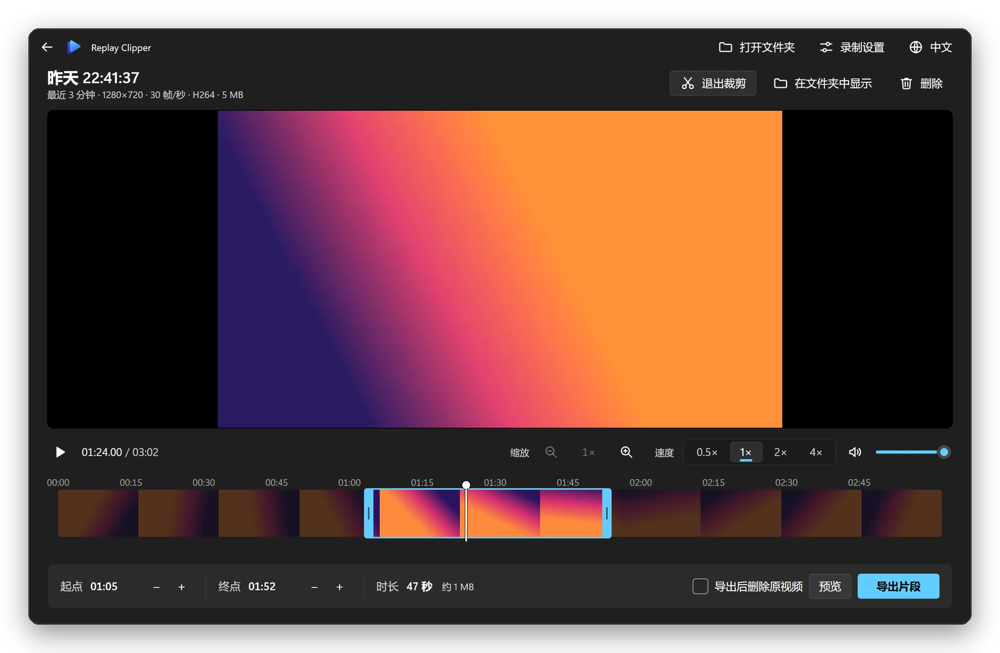

# Replay Clipper

**刚才那波操作，现在存还来得及。**

它一直在后台帮你录着，你只管玩。打出好操作了，按一下 `Alt + F7`，刚才那 3 分钟就存好了。 
用法跟游戏主机上的「保存最近的游戏画面」差不多，只不过这个是给 Windows 用的。

简体中文 · [English](README.en.md)

## 能做什么

### 录制
- 在后台录你选的那块屏幕，连同游戏声音。想把自己的声音也录进去，打开麦克风就行。
- 回放时长从 15 分钟到 12 小时随便设。它只留最近这一段，更早的自动删掉，不会越录越多。
- 缓存放在硬盘上，要占多少空间设置里直接算给你看。硬盘只剩不到 1 GB 时它会自己停下，不会把你的盘塞满。
- 用显卡的硬件编码录（N 卡 NVENC、A 卡 AMF、Intel Quick Sync），H.265 和 H.264 都支持。只有实在没有硬件编码器时才会用 CPU 软编，那样会掉帧，设置里也会提醒你。
- 分辨率可选 1080p、1440p 或屏幕原生分辨率，帧率 60 或 30。

### 保存
- 首页放了 5 个保存按钮，默认是 3、5、15、30 分钟。时长和快捷键都能改成你顺手的。
- 快捷键在游戏里直接按，不用切出去。右上角弹个小提示，“叮”一声就存好了。
- 不重新编码，画质跟录的时候一模一样。在我自己的电脑上（NVMe 固态硬盘），存 5 分钟大约 0.2 秒，存 30 分钟大约 1 秒，基本是按下去就好了。

### 回看和剪辑
- 片段列表带缩略图。可以 0.5× 慢放抠细节，也可以 4× 快进跳过跑图。
- 剪辑能精确到某一帧：滚轮放大时间轴，按 I / O 标好起点和终点，再一帧一帧地微调。导出同样不重新编码，画质不打折。

### 关掉窗口以后
- 点 × 时会问你是挂后台还是直接退出。嫌烦的话勾上「不再提醒」。
- 挂后台时它待在任务栏右下角的托盘里，右键菜单里也能直接保存、开关录制。
- 还可以让它开机自启、自动开录，以后就完全不用管了。

### 其他
- 不用另外装 OBS。录制用的是 OBS Studio 的核心库，已经打包在安装包里了。
- 中文 / English 界面，右上角随时切换。
- 安装不需要管理员权限。卸载时会把程序、设置和缓存清干净，你录好的片段一个都不会动。

## 截图

<table>
<tr>
<td width="50%">
时长和快捷键，改成你顺手的
</td>
<td width="50%">
录制设置，占多少硬盘一眼就能看到
</td>
</tr>
</table>

 慢放、逐帧剪辑，把高光单独切出来

## 安装

1. 去 [Releases](https://github.com/Lunafreya123/ReplayClipper/releases/latest) 下载 `ReplayClipper-Setup-x.y.z.exe`。
2. 双击安装。安装包暂时没有数字签名，Windows 可能会弹出「Windows 已保护你的电脑」，点「更多信息」，再点「仍要运行」就行。
3. 第一次打开会弹出「录制设置」。选好要录的屏幕，点「开始录制」，之后就不用管它了。

需要：

- Windows 10 或 11（64 位）
- WebView2 运行时（Windows 11 自带，Windows 10 一般装 Edge 时就有了）
- 最好有一块支持硬件编码的显卡，N 卡、A 卡、Intel 核显都可以

## 默认快捷键

| 保存最近 | 快捷键 |
| --- | --- |
| 3 分钟 | `Alt + F7` |
| 5 分钟 | `Alt + F8` |
| 15 分钟 | `Alt + F9` |
| 30 分钟 | `Alt + F10` |

想改的话，点首页时长按钮后面的「编辑」，最多可以设 5 个。F1 到 F12 这类功能键可以单独用，其他键得配上 Ctrl 或 Alt。

## 常见问题

**存得这么快，是不是偷偷压了画质？**
没有。录的时候画面就已经按每 2 秒一段存进硬盘了，保存只是把需要的那几段拼成一个 MP4，全程不重新编码。

**会不会卡游戏？**
编码交给显卡里专门干这个的编码单元。在我电脑上，录制组件本身只占一个 CPU 核心的 7% 左右。不过如果显卡没有硬件编码、只能用 CPU 软编，那就会明显掉帧了。

**要占多大硬盘？**
按默认设置（1080p、60 帧，约 16 Mbps）算，留 30 分钟大概要 3.5 GB，留 1 小时大概 7 GB。你自己的设置要多少，「录制设置」里会直接显示。

**录好的视频在哪？**
默认在「视频」文件夹下的 Replay Clipper 里，也可以在「录制设置」里换个地方。标题栏的「打开文件夹」点一下就到。

**关了窗口还在录吗？**
选了挂后台就还在录，快捷键照样能用。从托盘菜单点「退出」才是真的关掉，这时还没保存的画面就没了，所以退出前记得先存。

## 它是怎么做到秒存的

- **程序本体**（`src/`）：用 C# 写的，管窗口、快捷键和托盘图标。界面是一个网页文件（`ui/index.html`），用 WebView2 显示。
- **录制组件**（`engine/`）：一个没有窗口的小程序，调用 OBS Studio 33.0.1 的核心库来录画面和声音、用显卡编码，然后一段一段地写进硬盘上的循环缓存。程序跟它通过命名管道说话，它要是意外退出了，程序会马上把它拉起来。通信协议写在 [`src/engine/PROTOCOL.md`](src/engine/PROTOCOL.md)。
- **保存**：程序自己读缓存里的分段，直接写出 MP4。为了保险，每次保存还会让 ffmpeg 转一遍第一段做对照，两边必须逐字节一致才用；对不上就换 ffmpeg 来拼整个片段，慢一点，但稳。

## 目前的不足

- 我只在自己的 Windows 11 + AMD 显卡上完整测过。N 卡和 Intel 的编码参数是照着 OBS 的推荐值配的，还没在真机上跑过。用着有问题欢迎提 [Issue](https://github.com/Lunafreya123/ReplayClipper/issues)，附上 `data\engine\logs\engine.log` 会很有帮助。
- 独占全屏的游戏和 HDR 画面还没测过。
- 暂时不支持 AV1 编码。

## 自己编译

步骤写在英文说明的 [Building](README.en.md#building) 一节。大致是：用 Windows 自带的 C# 编译器跑一下 `build.cmd` 就能编出程序；录制组件、ffmpeg、WebView2 这些二进制文件没放进仓库，要照说明放到对应的文件夹；安装包用 Inno Setup 6 打（`installer\build-installer.cmd`）。

## 许可

本项目按 [GPL-3.0](LICENSE) 许可发布，其中录制组件的辅助程序（`src/engine/`）是 GPL-2.0-or-later。
安装包里附带的 OBS Studio 核心库、FFmpeg 等第三方组件的版本、许可和源代码位置，见 [`engine/licenses/THIRD-PARTY-NOTICES.txt`](engine/licenses/THIRD-PARTY-NOTICES.txt) 和 [`ffmpeg/README.txt`](ffmpeg/README.txt)。

“OBS”和“OBS Studio”是其各自所有者的商标。Replay Clipper 跟 OBS 项目没有关系，也没有得到他们的认可。
