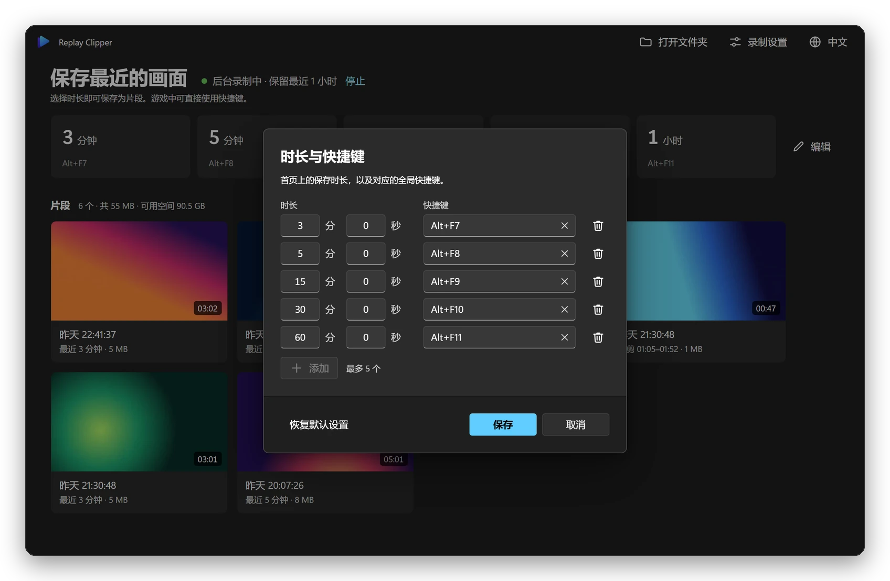

# Replay Clipper

**刚才那波操作，现在存下来还来得及。**

像游戏主机的「保存最近的游戏画面」一样：在后台持续录制，按一下快捷键， 
就把最近 3 分钟、5 分钟、30 分钟的画面存成视频。

简体中文 · [English](README.en.md)

## 功能

### 后台录制，随时回看
- 持续录制所选的显示器和系统声音，也可以一起录麦克风。只保留最近一段时间，更早的画面自动丢弃。
- 回放时长可选 15 分钟、30 分钟、1 小时、2 小时，也可以自定义为 1 到 720 分钟（12 小时）。
- 回放缓存存在磁盘上，不占用大量内存。设置里会根据分辨率、帧率和时长算出预计占用的空间，同时显示剩余空间。剩余空间不足 1 GB 时录制自动停止，不会把磁盘写满。

### 一键保存，基本不用等
- 首页最多放 5 个保存时长，默认 3、5、15、30 分钟。每个时长都能改，也都能绑定快捷键。
- 快捷键全局生效，在游戏里直接按就行。屏幕右上角会弹出一条小提示，保存完成时有提示音。
- 保存时直接拼接已录好的画面，不重新编码，画质没有任何损失。在开发用的电脑上（NVMe 固态硬盘）实测，保存 5 分钟大约 0.2 秒，30 分钟大约 1 秒。

### 显卡编码，不拖帧率
- 自动选用 NVIDIA NVENC、AMD AMF 或 Intel Quick Sync 硬件编码器，支持 H.265 和 H.264。只有在没有可用的显卡编码器时才改用软件编码，并会提示你。
- 分辨率可选 1080p、1440p 或显示器原始分辨率，帧率可选 60 或 30 帧。

### 内置播放和无损裁剪
- 片段库自带缩略图，播放支持 0.5× 到 4× 变速。
- 裁剪可以精确到帧：滚轮缩放时间轴，按 I / O 设起点和终点，逐帧微调。导出时同样不重新编码。

### 像普通软件一样常驻托盘
- 点关闭时会问你「后台运行」还是「退出」，勾选「不再提醒」后不再询问。
- 托盘菜单里可以直接保存、开始或停止录制。
- 可以设置开机自动启动并在后台录制。

### 装上就能用
- 不需要另外安装 OBS。录制组件基于 OBS Studio 的核心库，已经打包在安装包里。
- 中文和 English 界面，右上角随时切换。
- 安装不需要管理员权限。卸载时清理干净，已保存的片段会保留。

## 截图

<table>
<tr>
<td width="50%">
保存时长和快捷键都能自己设
</td>
<td width="50%">
录制设置，实时估算磁盘占用
</td>
</tr>
</table>

 播放和逐帧裁剪

## 安装

1. 打开 [Releases](https://github.com/Lunafreya123/ReplayClipper/releases/latest)，下载 `ReplayClipper-Setup-x.y.z.exe`。
2. 运行安装程序。安装包没有数字签名，Windows 可能会提示「Windows 已保护你的电脑」，选择「更多信息」→「仍要运行」即可。
3. 第一次启动会打开「录制设置」。选好要录的显示器，点「开始录制」。之后程序会在后台一直录制。

运行环境：

- Windows 10 或 11，64 位
- WebView2 运行时（Windows 11 自带，Windows 10 一般已经随 Edge 装好）
- 建议使用带硬件编码的独立显卡或核显（NVIDIA / AMD / Intel）

## 默认快捷键

| 保存最近 | 快捷键 |
| --- | --- |
| 3 分钟 | `Alt + F7` |
| 5 分钟 | `Alt + F8` |
| 15 分钟 | `Alt + F9` |
| 30 分钟 | `Alt + F10` |

在首页时长方块后面点「编辑」可以修改，最多 5 个。功能键可以单独使用，其他键需要搭配 Ctrl 或 Alt。

## 常见问题

**保存为什么这么快？**
录制时画面就已经按 2 秒一段写在磁盘上。保存时只把需要的那几段直接拼成 MP4，不重新编码，所以几乎不用等。

**会影响游戏帧率吗？**
编码交给显卡的专用编码单元，基本不占游戏的算力。在开发用的电脑上，录制组件本身大约占一个 CPU 核心的 7%。

**要占多少硬盘？**
默认 1080p 60 帧，码率约 16 Mbps：保留 30 分钟约 3.5 GB，1 小时约 7 GB。具体数字以「录制设置」里显示的为准。

**片段存在哪里？**
默认在「视频\Replay Clipper」文件夹，可以在「录制设置」里改成任意文件夹。点标题栏的「打开文件夹」可以直接打开。

**关掉窗口还会录吗？**
选了「后台运行」就会继续录制，快捷键照常可用。从托盘菜单选「退出」才会真正关闭，没保存的画面会丢弃。

## 工作原理

- **程序**（`src/`）：C# 编写的窗口和后台服务，界面是单文件网页（`ui/index.html`），通过 WebView2 显示。
- **录制组件**（`engine/`）：一个无界面的辅助程序，调用 OBS Studio 33.0.1 的核心库进行屏幕和声音采集、硬件编码，把画面写进磁盘上的循环缓存。程序和它通过命名管道通信，它崩溃时会被自动重启。
- **保存**：程序直接读取缓存里的分段，自己写出 MP4 文件。每次保存都会用 ffmpeg 转换第一段作为对照，结果必须逐字节一致才采用；有任何不一致就改用 ffmpeg 完整拼接，保证不会存出坏文件。

## 已知限制

- 目前只在 Windows 11 和 AMD 显卡上完整测试过。NVIDIA 和 Intel 编码器按 OBS 的推荐参数配置，还没有实机验证，遇到问题欢迎提 [Issue](https://github.com/Lunafreya123/ReplayClipper/issues)，并附上 `data\engine\logs\engine.log`。
- 还没有测试独占全屏游戏和 HDR 画面。
- 暂不提供 AV1 编码。

## 从源码构建

见 [English README 的 Building 一节](README.en.md#building)。简单来说：用 Windows 自带的 C# 编译器运行 `build.cmd` 即可编译程序；录制组件、ffmpeg 和 WebView2 这些二进制依赖不放在仓库里，需要按说明放到对应文件夹；安装包用 Inno Setup 6 生成（`installer\build-installer.cmd`）。

## 许可

本项目以 [GPL-3.0](LICENSE) 许可发布。录制组件辅助程序（`src/engine/`）为 GPL-2.0-or-later。
安装包中附带的 OBS Studio 核心库、FFmpeg 等第三方组件的版本、许可和源代码位置见 [`engine/licenses/THIRD-PARTY-NOTICES.txt`](engine/licenses/THIRD-PARTY-NOTICES.txt)。

“OBS” 和 “OBS Studio” 是其所有者的商标。Replay Clipper 与 OBS 项目没有关联，也未获得其认可。
