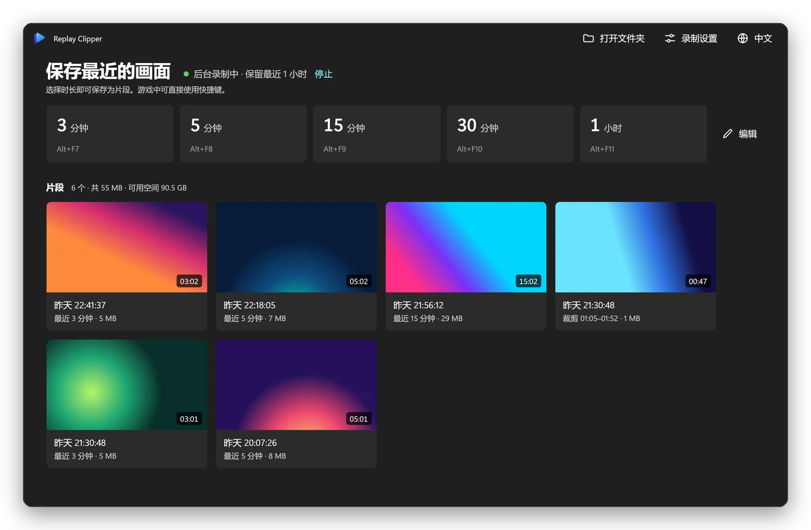
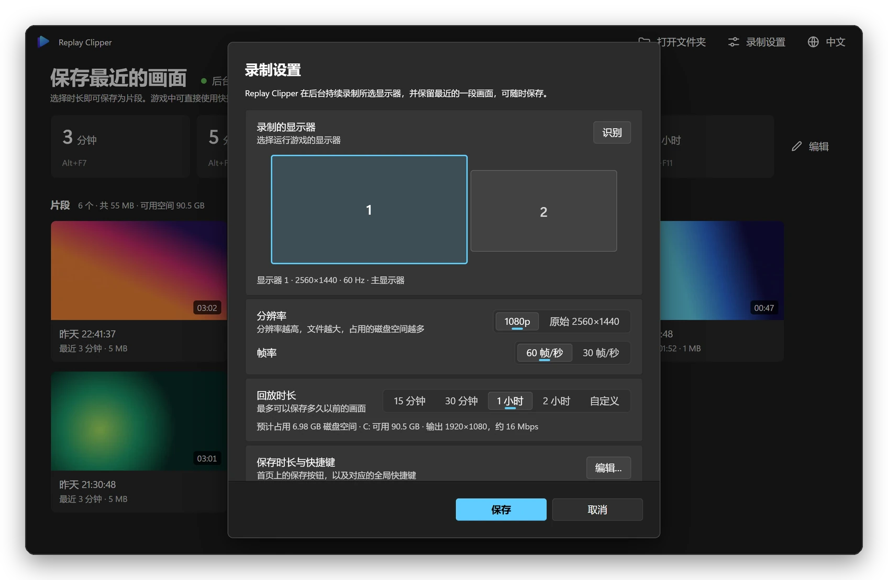

<div align="center">


# Replay Clipper

Windows 平台的游戏回放录制工具

[](https://github.com/Lunafreya123/ReplayClipper/releases/latest)

[](LICENSE)

[下载](https://github.com/Lunafreya123/ReplayClipper/releases/latest) · [问题反馈](https://github.com/Lunafreya123/ReplayClipper/issues) · [English](README.en.md)

</div>

Replay Clipper 在后台持续录制屏幕，并通过全局快捷键将最近一段时间的画面保存为视频文件，功能与游戏主机上的“保存最近的游戏画面”类似。录制基于 OBS Studio 的核心库，保存时直接拼接已录制的内容，不重新编码。

<p align="center"></p>

## 特性

- **后台持续录制**：录制所选显示器的画面与系统声音，可选同时录制麦克风。回放时长可设为 15 分钟至 12 小时，超出部分自动删除。
- **快捷键保存**：最多 5 个保存时长（默认 3、5、15、30 分钟），每个时长可单独绑定全局快捷键，在游戏中可直接使用。
- **无损、快速保存**：保存时直接拼接磁盘缓存中的分段，不重新编码，画质与录制时一致。保存 30 分钟的片段约需 1 秒（见[性能](#性能)）。
- **硬件编码**：支持 NVIDIA NVENC、AMD AMF 与 Intel Quick Sync，输出 H.265 或 H.264；没有可用的硬件编码器时回退至软件编码。分辨率可选 1080p、1440p 或原始分辨率，帧率可选 60 或 30 fps。
- **磁盘缓存**：回放缓存存放在磁盘上，设置界面按分辨率、帧率与回放时长估算所需空间；磁盘剩余空间低于 1 GB 时自动停止录制。
- **播放与剪辑**：内置播放器，支持 0.5×–4× 变速；剪辑可精确到帧，导出时不重新编码。
- **系统托盘**：关闭窗口后可继续在后台运行，支持托盘菜单操作与开机自启。
- **独立运行**：录制组件随安装包提供，无需安装 OBS；安装无需管理员权限。
- **双语界面**：简体中文与 English。

## 截图

<table>
<tr>
<td width="50%"><p align="center">时长与快捷键</p></td>
<td width="50%"><p align="center">录制设置</p></td>
</tr>
</table>

<p align="center"><br>播放与剪辑</p>

## 安装

从 [Releases](https://github.com/Lunafreya123/ReplayClipper/releases/latest) 页面下载 `ReplayClipper-Setup-x.y.z.exe` 并运行。默认安装到 `%LOCALAPPDATA%\Programs\ReplayClipper`，可在安装时更改。

> [!NOTE]
> 安装程序未进行代码签名。如果 Windows SmartScreen 显示“Windows 已保护你的电脑”，请选择“更多信息”→“仍要运行”。

**系统要求**

- Windows 10 或 Windows 11（64 位）
- WebView2 运行时（Windows 11 已内置；Windows 10 通常随 Microsoft Edge 安装）
- 推荐使用支持硬件编码的 NVIDIA、AMD 或 Intel 显卡

## 使用

1. 首次启动时会打开“录制设置”。选择要录制的显示器并确认各项设置，然后选择“开始录制”。
2. 程序随后在后台持续录制。需要保存时，按下对应的快捷键，或在主界面选择保存时长。
3. 保存的片段显示在主界面的片段列表中，可直接播放、剪辑或在文件夹中打开。

**默认快捷键**

| 操作 | 快捷键 |
| --- | --- |
| 保存最近 3 分钟 | `Alt` + `F7` |
| 保存最近 5 分钟 | `Alt` + `F8` |
| 保存最近 15 分钟 | `Alt` + `F9` |
| 保存最近 30 分钟 | `Alt` + `F10` |

在主界面选择保存时长后面的“编辑”，可修改时长与快捷键。功能键可单独使用，其他按键需与 `Ctrl` 或 `Alt` 组合。

**剪辑快捷键**

| 按键 | 作用 |
| --- | --- |
| 鼠标滚轮 | 以指针位置为中心缩放时间轴 |
| `Shift` + 鼠标滚轮 | 平移时间轴 |
| `I` / `O` | 将当前位置设为起点 / 终点 |
| `←` / `→` | 后退 / 前进 1 秒；剪辑时为 1 帧 |
| `Space` | 播放 / 暂停 |

**文件位置**

| 内容 | 默认位置 |
| --- | --- |
| 保存的片段 | `视频\Replay Clipper`，可在“录制设置”中更改 |
| 回放缓存 | 程序目录下的 `data\buffer`，可在“录制设置”中更改 |
| 设置与日志 | 程序目录下的 `data` |

## 性能

保存片段时，Replay Clipper 直接读取缓存中的 MPEG-TS 分段并写出 MP4 文件，耗时主要取决于磁盘读写速度。下表为不同长度片段的保存耗时，并与使用 ffmpeg 拼接相同内容进行对比：

| 片段长度 | Replay Clipper | ffmpeg 拼接 |
| --- | ---: | ---: |
| 5 分钟 | 约 0.2 秒 | 约 1 秒 |
| 30 分钟 | 约 0.9 秒 | 约 5 秒 |
| 60 分钟 | 约 2 秒 | 约 10 秒 |

测试环境：Windows 11，AMD 显卡（AMF H.265），NVMe SSD，1080p 60 fps，码率约 16 Mbps。录制期间，录制组件约占用单个 CPU 核心的 7%。

## 架构


| 组件 | 路径 | 说明 |
| --- | --- | --- |
| 应用程序 | `src/` | C#（.NET Framework 4.x）。负责窗口、全局快捷键、托盘图标、本地 HTTP 接口与 MP4 写入 |
| 用户界面 | `ui/index.html` | 单文件 Web 界面，通过 WebView2 显示 |
| 录制组件 | `src/engine/` | 无界面的辅助进程，调用 OBS Studio 33.0.1 的 libobs 进行采集与编码，写入磁盘环形缓存。与应用程序通过命名管道通信（[协议](src/engine/PROTOCOL.md)），异常退出后由应用程序自动重启 |
| ffmpeg | `ffmpeg/` | 精简构建的 FFmpeg 9.0.2，用于保存校验、回退拼接、剪辑导出、读取视频信息与生成缩略图 |
| 安装程序 | `installer/` | Inno Setup 6 |

每次保存时，ffmpeg 会同时转换片段的第一个分段作为参照，应用程序写出的结果必须与之逐字节一致才会采用；不一致时改为由 ffmpeg 拼接整个片段。

## 已知问题

- 目前仅在 Windows 11 与 AMD 显卡上完成完整测试。NVIDIA 与 Intel 编码器的参数参照 OBS 的推荐设置，尚未在实际硬件上验证。
- 尚未测试独占全屏模式的游戏与 HDR 输出。
- 暂不支持 AV1 编码。

## 从源码构建

项目使用 Windows 自带的 C# 编译器（.NET Framework 4.x），不需要 Visual Studio。录制组件、ffmpeg 与 WebView2 等二进制依赖不包含在仓库中，获取方式见 [Building](README.en.md#building)。

```bat
build.cmd                       :: 编译 ReplayClipper.exe、Uninstall.exe 与录制组件
installer\build-installer.cmd   :: 生成 dist\ReplayClipper-Setup-<version>.exe（需要 Inno Setup 6）
```

## 参与贡献

欢迎通过 [Issues](https://github.com/Lunafreya123/ReplayClipper/issues) 报告问题或提出建议，也欢迎提交 Pull Request。报告录制相关的问题时，请注明 Windows 版本与显卡型号，并附上 `data\engine\logs\engine.log`。

## 许可证

本项目基于 [GPL-3.0](LICENSE) 许可证发布；录制组件（`src/engine/`）基于 GPL-2.0-or-later。

第三方组件的版本、许可证与源代码位置见 [`engine/licenses/THIRD-PARTY-NOTICES.txt`](engine/licenses/THIRD-PARTY-NOTICES.txt) 与 [`ffmpeg/README.txt`](ffmpeg/README.txt)。

## 致谢

- [OBS Studio](https://obsproject.com/)：录制组件所使用的 libobs 及插件
- [FFmpeg](https://ffmpeg.org/)：保存校验、剪辑与缩略图
- [Microsoft WebView2](https://developer.microsoft.com/microsoft-edge/webview2/)：用户界面
- [Inno Setup](https://jrsoftware.org/isinfo.php)：安装程序

“OBS”与“OBS Studio”是其各自所有者的商标。本项目与 OBS 项目无关联，亦未获得其认可。
